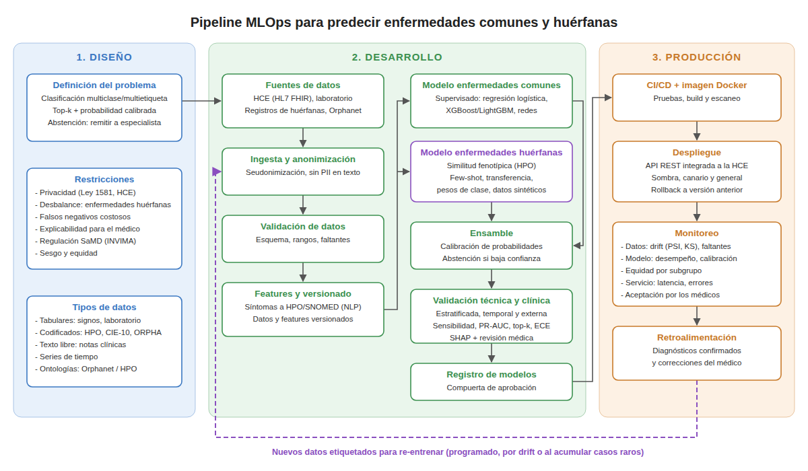

# Pipeline de MLOps para predecir enfermedades a partir de síntomas

El modelo recibe los síntomas de un paciente y devuelve las enfermedades más probables con su probabilidad, para que el médico las tenga en cuenta en el diagnóstico. Debe funcionar con enfermedades comunes, que tienen miles de casos, y con enfermedades huérfanas, que tienen muy pocos.

## 1. Diseño

Es un problema de clasificación multietiqueta, porque un paciente puede tener más de una enfermedad. La salida son las k enfermedades más probables con su probabilidad calibrada. Si la confianza es baja, el modelo marca el caso como no concluyente y sugiere remitir a un especialista.

Restricciones:

- Los datos vienen de historias clínicas, así que aplica la Ley 1581 de 2012. Se anonimizan en el origen y el acceso queda auditado.
- Las clases están muy desbalanceadas y un único clasificador supervisado no aprende las huérfanas.
- Un falso negativo cuesta más que un falso positivo, por lo que se prioriza la sensibilidad y el umbral se ajusta por enfermedad.
- El médico necesita ver qué síntomas pesaron en cada predicción.
- Si se usa como dispositivo médico debe cumplir la regulación del INVIMA, lo que exige trazabilidad de datos y modelos.
- El desempeño se revisa por sexo, edad y región para detectar sesgos.

Tipos de datos:

- Signos vitales, edad, sexo y resultados de laboratorio (tabulares).
- Síntomas codificados con SNOMED o HPO.
- Diagnósticos en CIE-10 y códigos ORPHA, que sirven de etiquetas.
- Notas clínicas en texto libre.
- Series de tiempo de consultas sucesivas.
- Asociaciones enfermedad-fenotipo de Orphanet y HPO.

## 2. Desarrollo

### Datos

Las fuentes son la historia clínica electrónica (HL7 FHIR), los sistemas de laboratorio, los registros de enfermedades huérfanas, Orphanet, HPO y casos publicados en la literatura. MIMIC puede usarse para preentrenar.

1. Ingesta periódica y seudonimización, incluyendo los identificadores que aparezcan en las notas.
2. Validación de esquema, rangos fisiológicos, duplicados y faltantes. Un lote que falla no entra al entrenamiento.
3. Mapeo de síntomas a una terminología común y extracción de síntomas de las notas con NLP.
4. Versionado de datos y features.
5. Etiquetado con el diagnóstico confirmado. Los casos raros los revisa un médico.

### Modelos

Para enfermedades comunes se entrena un modelo supervisado. La línea base es una regresión logística y los candidatos son XGBoost o LightGBM. Si se incluyen las notas clínicas, se puede usar un transformer.

Para enfermedades huérfanas se combinan varias técnicas:

- Similitud entre los síntomas del paciente y el perfil HPO de cada enfermedad, que funciona aunque no haya casos locales.
- Few-shot learning con redes prototípicas sobre embeddings de pacientes.
- Transfer learning desde el modelo de enfermedades comunes.
- Pesos de clase o focal loss, y datos sintéticos revisados por médicos.
- Clasificación jerárquica por grupo de enfermedad.

Un ensamble combina ambas ramas, calibra las probabilidades (Platt o isotónica) y decide cuándo abstenerse.

### Validación

La partición se hace por paciente, con validación cruzada estratificada y leave-one-out en las clases con muy pocos casos. También se valida en el tiempo (entrenar con datos antiguos y probar con recientes) y con datos de otro hospital.

Las métricas son sensibilidad y especificidad por clase, PR-AUC, F1 macro, top-k accuracy, calibración (Brier, ECE) y equidad por subgrupo. Los médicos revisan las explicaciones SHAP. El modelo pasa al registro solo si supera al modelo actual y cumple los umbrales clínicos acordados.

## 3. Producción

### Despliegue

El modelo aprobado se empaqueta en una imagen Docker con una API REST (ver punto 2), y un flujo de CI/CD corre las pruebas y construye la imagen. La API se integra con la historia clínica. Primero corre en modo sombra, comparando sus predicciones con el diagnóstico real. Después pasa a un grupo pequeño de médicos y luego a todos, con la opción de volver a la versión anterior.

### Monitoreo

- Datos: drift de síntomas y variables (PSI, KS), faltantes y valores fuera de rango.
- Modelo: desempeño contra diagnósticos confirmados, tasa de abstención, calibración y equidad.
- Servicio: latencia, disponibilidad y errores.
- Uso: cuántas sugerencias aceptan o rechazan los médicos.

### Re-entrenamiento

Cada diagnóstico confirmado y cada corrección del médico vuelve a la ingesta como dato etiquetado. Se re-entrena cada trimestre para las enfermedades comunes, cuando hay drift o cae el desempeño, y cuando se acumulan casos de una huérfana o se actualizan Orphanet y HPO. El modelo nuevo pasa por la misma validación antes de reemplazar al actual.
